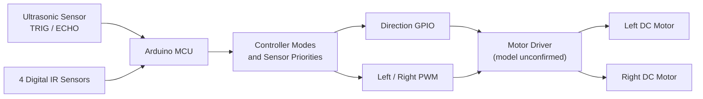
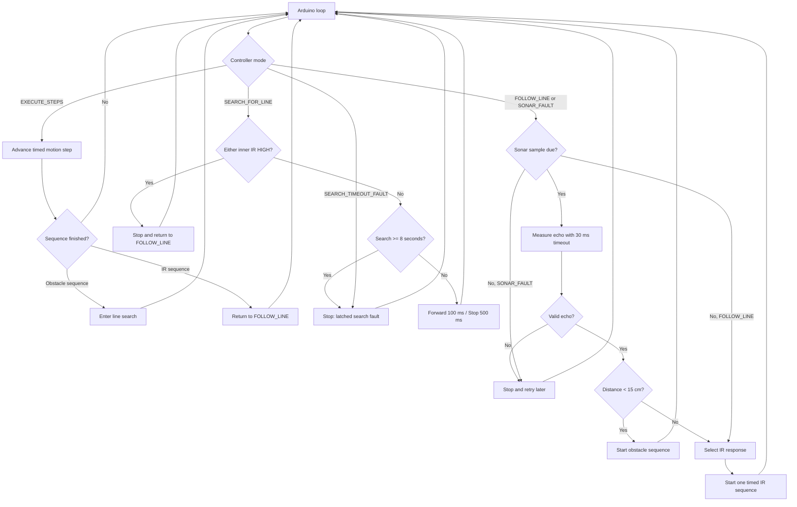

# Arduino Autonomous Robot Car

An embedded robotics project combining **four digital IR sensors**, **ultrasonic obstacle detection**, and **independent PWM motor control**. The current firmware refactors an earlier Arduino sketch into a **mode-based controller with prioritized sensor decisions, timed motion sequences, and explicit fault handling**.

> **Status:** Refactored firmware available; **physical robot validation pending**. The original Version 3 pin assignments, PWM settings, and programmed maneuver durations are preserved, but the new control behavior has not been verified on the original hardware.

## Contents

- [Project overview](#project-overview)
- [System architecture](#system-architecture)
- [Controller decision flow](#controller-decision-flow)
- [Sensor decision table](#sensor-decision-table)
- [Obstacle avoidance and line recovery](#obstacle-avoidance-and-line-recovery)
- [Hardware interfaces and PWM](#hardware-interfaces-and-pwm)
- [Firmware design and engineering decisions](#firmware-design-and-engineering-decisions)
- [Build and validation](#build-and-validation)
- [Limitations and future work](#limitations-and-future-work)
- [Repository structure](#repository-structure)

## Project overview

The robot combines two behaviors:

1. **Line-responsive driving:** four digital infrared inputs select forward, reverse, or corrective turning motions.
2. **Obstacle handling:** an ultrasonic reading below **15 cm** starts a fixed left-turn / forward / right-turn sequence, followed by a timed search for the line.

The controller uses **rule-based navigation and open-loop motor timings**. It does not implement SLAM, PID tracking, odometry, or an RTOS.

| Feature | Current implementation |
|---|---|
| IR inputs | 2 inner + 2 outer digital sensors |
| Distance measurement | Ultrasonic TRIG/ECHO, 30 ms echo timeout |
| Motor drive | GPIO direction pins + independent left/right PWM |
| Control structure | Five controller modes and prioritized IR decisions |
| Motion timing | `millis()`-based steps; ultrasonic `pulseIn()` remains blocking |
| Fault handling | Sonar no-echo stop/retry; 8-second line-search timeout |
| Hardware validation | **Pending for refactored firmware** |

## System architecture



The diagram represents the signal-level architecture inferred from the firmware. The exact Arduino board, motor-driver model, and sensor modules are not yet confirmed.

## Controller decision flow

The firmware runs **one selected motion sequence at a time**. This is intentionally different from the original Version 3, whose independent `if` statements could initiate multiple actions in a single loop iteration.



**Priority:** a detected obstacle takes precedence at ultrasonic sample time; otherwise outer IR corrections are checked before inner IR combinations. Sonar is not resampled during an active motion sequence or line search.

## Sensor decision table

This table reflects `chooseLineAction()` in the **refactored firmware**. `1` means digital `HIGH` and `0` means digital `LOW`; these are raw input values, **not confirmed black/white interpretations**.

| Priority | Outer right D2 | Outer left D11 | Inner left D12 | Inner right D3 | Programmed action |
|---:|:---:|:---:|:---:|:---:|---|
| 1 | 1 | 0 | Any | Any | Reverse 30 ms → right 300 ms → stop 10 ms |
| 2 | 0 | 1 | Any | Any | Reverse 30 ms → left 500 ms → stop 10 ms |
| 3 | Equal outer readings | Equal | 1 | 1 | Stop 100 ms → forward 100 ms |
| 4 | Equal outer readings | Equal | 0 | 1 | Left 30 ms → stop 10 ms |
| 5 | Equal outer readings | Equal | 1 | 0 | Right 30 ms → stop 10 ms |
| 6 | Equal outer readings | Equal | 0 | 0 | Stop 100 ms → reverse 50 ms |

**Equal outer readings** means D2/D11 are both `0` or both `1`. IR electrical polarity and actual wheel response must be confirmed on the robot.

## Obstacle avoidance and line recovery

A **valid** ultrasonic measurement below **15 cm** triggers this sequence:

| Step | Motion | Duration |
|---:|---|---:|
| 1 | Stop | 1,000 ms |
| 2 | Turn left | 700 ms |
| 3 | Stop | 1,000 ms |
| 4 | Forward | 500 ms |
| 5 | Stop | 1,000 ms |
| 6 | Turn right | 750 ms |
| 7 | Stop | 1,000 ms |
| 8 | Search: forward / stop | 100 ms / 500 ms, repeated |
| 9 | Exit search | Either inner IR reads `HIGH`, or stop at 8-second timeout |

Steps 1–8 retain the original Version 3 motion pattern and timings. The **8-second timeout is new**, introduced to prevent indefinite search; it has **not** been experimentally tuned.

The sequence is fixed-time and open-loop, so the actual travel path depends on wheel traction, surface conditions, battery voltage, and motor performance.

## Hardware interfaces and PWM

### Pin mapping

| Interface | Arduino pin | Direction |
|---|---|---|
| Ultrasonic TRIG / ECHO | D13 / D4 | Output / input |
| Left motor direction | D8 / D9 | Output |
| Left motor PWM | D10 | PWM output |
| Right motor direction | D7 / D6 | Output |
| Right motor PWM | D5 | PWM output |
| Inner right / left IR | D3 / D12 | Input |
| Outer right / left IR | D2 / D11 | Input |

### Motor PWM values

| Motion | Left PWM | Right PWM |
|---|---:|---:|
| Forward | 150 | 158 |
| Backward | 150 | 158 |
| Turn left | 0 | 125 |
| Turn right | 130 | 0 |
| Stop | 0 | 0 |

PWM values and direction-pin logic were inherited from Version 3; **no new motor calibration results are claimed**.

## Firmware design and engineering decisions

The main sketch is [`firmware/robot_car_v3_refactored/robot_car_v3_refactored.ino`](firmware/robot_car_v3_refactored/robot_car_v3_refactored.ino).

| Original V3 behavior | Refactored implementation | Engineering purpose |
|---|---|---|
| Multiple independent movement `if` statements | Prioritized `if / else if` selection | Avoid conflicting plans in one evaluation |
| Blocking `delay()` during movement | `millis()`-based timed steps | Structure time-controlled motion without long `delay()` calls |
| `pulseIn()` with no explicit timeout | 30 ms echo timeout | Bound ultrasonic waiting time |
| No echo could produce 0 cm | `SONAR_FAULT`: stop and retry | Separate missing data from a close obstacle |
| Unbounded post-obstacle search | 8-second timeout, latched fault | Limit indefinite movement |
| Implicit sequencing | `FOLLOW_LINE`, `EXECUTE_STEPS`, `SEARCH_FOR_LINE` and fault modes | Make transitions inspectable |

Key functions include `drive(Motion)`, `startTimedSteps()`, `updateTimedSteps()`, `measureDistanceCm()` and `chooseLineAction()`.

These are **firmware changes**, not proof of improved physical tracking or avoidance performance.

## Build and validation

1. Install **Arduino IDE** and choose the actual board and serial port.
2. Open [`robot_car_v3_refactored.ino`](firmware/robot_car_v3_refactored/robot_car_v3_refactored.ino).
3. Run **Verify / Compile** for the selected board.
4. Confirm wiring, motor-driver voltage requirements, and IR sensor signal polarity.
5. Test motor direction with the wheels **raised off the ground**.
6. Check sonar distance readings, no-echo behavior, line tracking, obstacle avoidance, and search timeout in a controlled environment.

See the [hardware validation checklist](docs/validation_checklist.md) for test steps.

| Validation item | Status |
|---|---|
| Source-level refactor | Completed |
| Arduino board-specific compilation | **Not yet confirmed** |
| Pin wiring and motor direction | **Not yet confirmed** |
| IR polarity and sonar behavior | **Not yet confirmed** |
| End-to-end physical testing of refactored firmware | **Not yet completed** |
| Quantified success rate / response latency | **Not measured** |

## Limitations and future work

- **Partial blocking remains:** ultrasonic `pulseIn()` can wait up to 30 ms; the controller is not fully non-blocking.
- **No continuous sensing during maneuvers:** obstacle distance is not checked during active timed steps or line recovery.
- **Conservative no-echo behavior:** an out-of-range object or weak reflection may stop the robot until a valid echo returns.
- **Open-loop movements:** fixed motor timings do not compensate for battery variation, wheel slip, or changing surfaces.
- **Sensor polarity not revalidated:** the firmware uses raw digital states; black/white mapping must be checked on hardware.
- **Search timeout not tuned:** 8 seconds is a proposed safety bound, not a measured optimum.

**Possible next steps:** bench compilation and physical validation, serial logging of state transitions, safer timeout recovery, and measured line-following/obstacle-avoidance tests.

## Repository structure

```text
Arduino-Autonomous-Robot-Car/
├── firmware/
│   └── robot_car_v3_refactored/
│       └── robot_car_v3_refactored.ino
├── docs/
│   └── validation_checklist.md
└── README.md
```

*Demo video and hardware photos will be added after editing and verification.*

## Author

**Hoi Chun (Chris) Wat**  
M.S. Electrical and Computer Engineering · University of Florida
