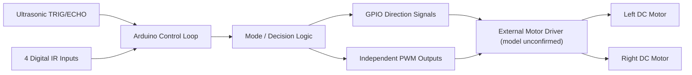
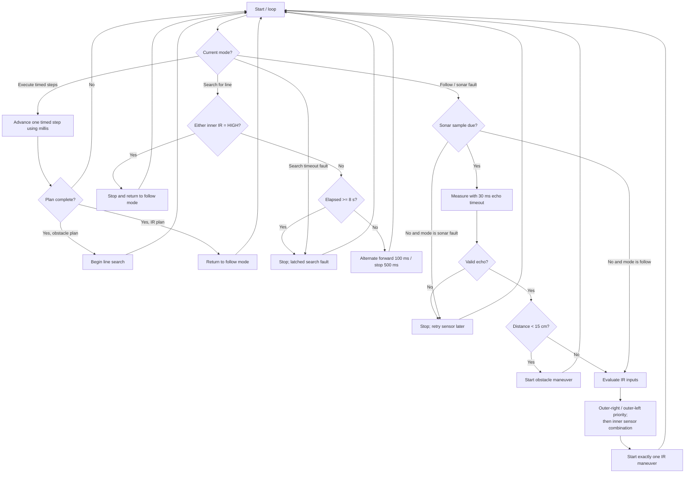
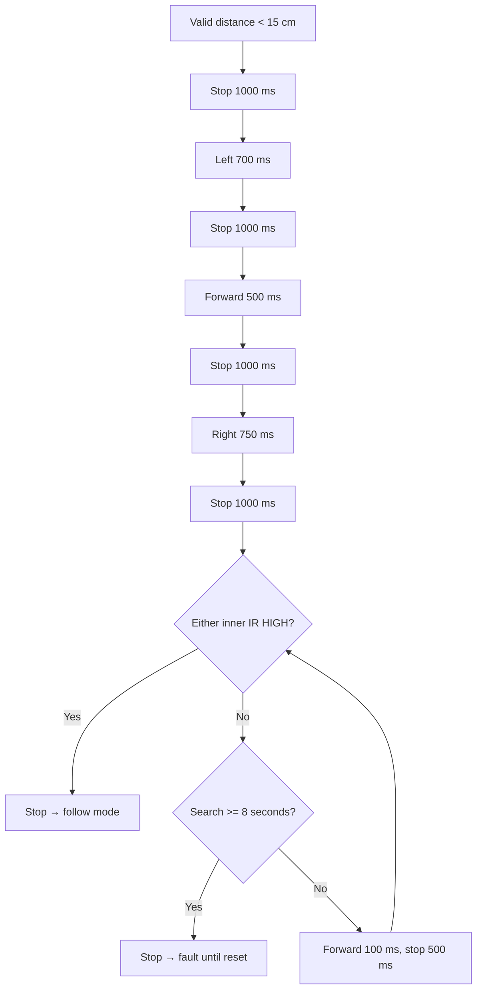

# Arduino Autonomous Robot Car — V3 Refactored

A hardware-oriented Arduino robot-car firmware project featuring four digital infrared sensors, ultrasonic obstacle sensing, and independent left/right PWM motor control. This branch of the project is a **safety-oriented refactor of the author's Version 3 sketch**: it keeps the documented wiring, motion commands, PWM calibration, and obstacle maneuver timings, while changing the control architecture and error handling.

> **Validation status:** Code-level refactor only. This version has **not been verified on the original physical robot**. The circuit, sensor polarities, motor directions, and updated behavior must be checked before a live demonstration. No performance claims or success rates are implied.

## Contents

- [Project scope](#project-scope)
- [System architecture](#system-architecture)
- [Controller decision flow](#controller-decision-flow)
- [Hardware and pin mapping](#hardware-and-pin-mapping)
- [Sensor decision table](#sensor-decision-table)
- [Obstacle-avoidance and search sequence](#obstacle-avoidance-and-search-sequence)
- [Firmware design](#firmware-design)
- [Changes from original Version 3](#changes-from-original-version-3)
- [Build and validation](#build-and-validation)
- [Known limitations and engineering trade-offs](#known-limitations-and-engineering-trade-offs)
- [Repository structure](#repository-structure)

## Project scope

This firmware combines line-responsive driving with a timed obstacle-avoidance sequence and a line reacquisition loop. It is a **rule-based mobile robot controller**, not autonomous mapping, SLAM, PID line control, or an RTOS-based system.

The original V3 sketch selected motion through multiple independent `if` statements and used blocking delays. This version replaces that behavior with a prioritized decision chain and an explicit controller mode.

## System architecture



## Controller decision flow



**Important distinction:** this is the **refactored control flow**. The original Version 3 could execute multiple IR `if` bodies during one iteration; this version intentionally chooses only one plan per evaluation.

## Hardware and pin mapping

| Interface | Arduino pin | Direction | Notes |
|---|---|---|---|
| Ultrasonic Trigger | D13 | Output | 10 microsecond trigger pulse |
| Ultrasonic Echo | D4 | Input | `pulseIn` with timeout |
| Left motor IN1 / IN2 | D8 / D9 | Output | Motor direction |
| Left motor PWM | D10 | PWM output | Left speed |
| Right motor IN1 / IN2 | D7 / D6 | Output | Motor direction |
| Right motor PWM | D5 | PWM output | Right speed |
| Inner right IR | D3 | Input | Digital sensor state |
| Inner left IR | D12 | Input | Digital sensor state |
| Outer right IR | D2 | Input | Boundary correction |
| Outer left IR | D11 | Input | Boundary correction |

The original board, motor driver, and sensor module models are not established by the sketch. The firmware assumes the V3 wiring and motor polarity. Original comments describe `HIGH = black`, `LOW = white`, but this must be verified on the actual sensor modules.

### PWM values

| Command | Left PWM | Right PWM | Direction behavior |
|---|---:|---:|---|
| Forward | 150 | 158 | Opposite left/right logic levels due to motor orientation |
| Backward | 150 | 158 | Reversed directions |
| Turn left | 0 | 125 | Right wheel drives |
| Turn right | 130 | 0 | Left wheel drives |
| Stop | 0 | 0 | Motor PWM disabled |

These values are inherited from V3; they have not been newly calibrated or characterized.

## Sensor decision table

The following is the **priority order of the refactored firmware**, after a valid sonar reading and only in line-follow mode. `1` means a `HIGH` digital reading; `0` means `LOW`.

| Priority | Outer right (D2) | Outer left (D11) | Inner left (D12) | Inner right (D3) | Selected response |
|---:|:---:|:---:|:---:|:---:|---|
| 1 | 1 | 0 | any | any | Backward 30 ms → right 300 ms → stop 10 ms |
| 2 | 0 | 1 | any | any | Backward 30 ms → left 500 ms → stop 10 ms |
| 3 | 0/1 | Same as right | 1 | 1 | Stop 100 ms → forward 100 ms |
| 4 | 0/1 | Same as right | 0 | 1 | Left 30 ms → stop 10 ms |
| 5 | 0/1 | Same as right | 1 | 0 | Right 30 ms → stop 10 ms |
| 6 | 0/1 | Same as right | 0 | 0 | Stop 100 ms → backward 50 ms |

The `0/1` notation in priorities 3–6 means **outer sensors are equal** (`0/0` or `1/1`), so neither outer correction triggers.

## Obstacle-avoidance and search sequence

**Trigger:** valid ultrasonic distance below 15 cm.

| Step | Action | Duration | Source |
|---:|---|---:|---|
| 1 | Stop | 1000 ms | V3 |
| 2 | Turn left | 700 ms | V3 |
| 3 | Stop | 1000 ms | V3 |
| 4 | Forward | 500 ms | V3 |
| 5 | Stop | 1000 ms | V3 |
| 6 | Turn right | 750 ms | V3 |
| 7 | Stop | 1000 ms | V3 |
| 8 | Forward 100 ms ↔ stop 500 ms | Repeat until either inner sensor reads HIGH | V3 pattern |
| 9 | Search timeout: stop and latch fault | 8 seconds from start of search | **New safety policy** |



The original source uses a `do ... while` with no maximum search duration. The finite timeout is deliberately introduced here and is not claimed as an original feature.

## Firmware design

The main sketch is at [`firmware/robot_car_v3_refactored/robot_car_v3_refactored.ino`](firmware/robot_car_v3_refactored/robot_car_v3_refactored.ino).

- **Motor driver abstraction:** `drive(Motion)` centralizes GPIO direction signals and PWM settings.
- **Timed sequence runner:** `startTimedSteps()` and `updateTimedSteps()` execute motor commands with `millis()` timestamps.
- **Controller modes:** `FOLLOW_LINE`, `EXECUTE_STEPS`, `SEARCH_FOR_LINE`, `SONAR_FAULT`, `SEARCH_TIMEOUT_FAULT`.
- **Range measurement:** `measureDistanceCm()` times the ultrasonic echo with a 30 ms timeout; a missing echo is invalid, not zero centimeters.
- **Decision priority:** obstacle handling takes precedence when sonar sampling is due; otherwise outer IR corrections take precedence over inner IR combinations.

## Changes from original Version 3

| Issue in Version 3 | Refactored behavior | Intentional difference? |
|---|---|---|
| Multiple independent IR `if` statements | Prioritized `if / else if` decision chain | **Yes**; only one action plan at a time |
| Multiple `delay()` calls | Timer-driven maneuver state using `millis()` | **Yes**; improved software responsiveness, but see limitations below |
| `pulseIn()` without explicit timeout | `pulseIn(..., 30000UL)` | **Yes**; bounded echo wait |
| Missing echo becomes zero-distance measurement | Enter stopped sonar-fault mode; auto-retry | **Yes**; fail-safe, but may stop in open space |
| Unbounded obstacle-recovery `do ... while` | 8-second search timeout; latched fault until reset | **Yes**; prevents indefinite driving |
| Unstructured motion logic | Named motion commands, timed sequences and controller modes | **Yes**; structure and control flow improved |
| Motor PWM and directions | Same as original V3 | No |
| Obstacle turn / drive / stop durations | Same as original V3 | No |

## Build and validation

1. Install the **Arduino IDE** and select the actual board and serial port.
2. Open `firmware/robot_car_v3_refactored/robot_car_v3_refactored.ino`.
3. Run **Verify / Compile** in the Arduino IDE.
4. Verify the pin mapping against the actual hardware. Check motor-driver and sensor electrical compatibility.
5. **Test with wheels raised off the ground first**; validate motor directions and PWM behavior.
6. Check inner and outer IR polarity on both black/white surfaces.
7. Check the ultrasonic echo with an object at a known distance.
8. Only then evaluate line following, obstacle clearance, recovery, no-echo handling, and the search timeout in a controlled area.

### Validation record

| Check | Current status |
|---|---|
| Arduino-board compilation | Not verified on a selected physical Arduino board |
| Actual pin wiring | Not verified |
| Wheel forward/reverse polarity | Not verified |
| IR black/white HIGH/LOW polarity | Not verified |
| Sonar distance and missing-echo behavior | Not verified on hardware |
| Search success, timeout and obstacle avoidance | Not verified on hardware |

This project does **not** report measured success rates, latency results, or end-to-end hardware validation for the refactored version.

## Known limitations and engineering trade-offs

- The firmware still uses `pulseIn()` (up to 30 ms blocking per ultrasonic measurement). It is **not fully non-blocking**.
- Ultrasonic reads are performed in follow/fault mode, **not during timed maneuvers or post-obstacle line search**. Obstacle events during those sequences are not detected by this firmware.
- Stopping on missing sonar echoes is a conservative policy. It can also immobilize the robot when an object is outside sensor range or the surface does not return an echo.
- The 8-second search limit is a **proposed safety setting**, not an experimentally tuned threshold. The actual robot may need a different value.
- Motion durations are open-loop; motor load, battery voltage, friction and floor geometry can change the resulting displacement.
- A `HIGH` signal is assumed to indicate a detected line when leaving search mode, based on the original V3 logic; actual sensor polarity requires verification.
- The original sketch is not an RTOS, PID, SLAM, odometry or map-based navigation implementation.

## Repository structure

```text
Arduino-Robot-Car-V3-Refactored/
├── firmware/
│   └── robot_car_v3_refactored/
│       └── robot_car_v3_refactored.ino
├── docs/
│   └── validation_checklist.md
└── README.md
```

## Author

Hoi Chun (Chris) Wat
